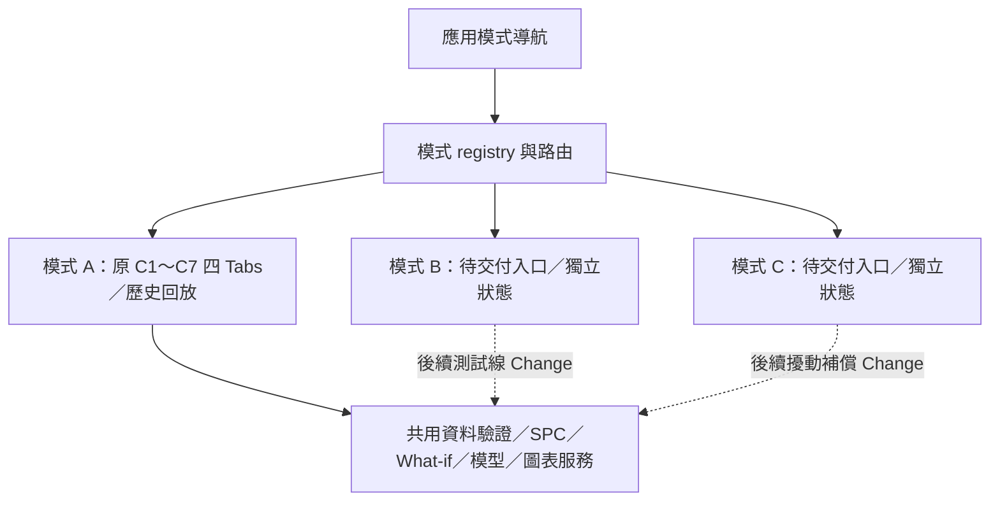

# Design

## Context

動機見 [proposal](proposal.md)。本案為待團隊審閱的規劃，所有下列新增架構都是 Proposed，不是正式主規格或實作完成宣告。

已確認 C1～C7 全部 Archive，C7 為 `2026-11-02-fccl-csv-replay`，原任務完成 29／39；目前主規格六份、Archive 五案。現有 app.py 呼叫 `ensure_workspace` 後組合 `render_dashboard`；`fccl_workspace` 是單個 WorkspaceState，內含 DataState、ReplayState、WhatIfState、ModelState、SpcState、VisualizationState。UI 各元件及資料載入／篩選接收此 state；成功換來源只重設該 state 的相依內容，失敗上傳保留原資料。

`quality/` 透過具名 PredictionInput／ModelAdapter 工作；`spc/` 與 `visualization/` 使用明確切片／版本及固定基準。現有 What-if UI 有全域 widget keys，圖表 key 尚無應用模式維度；同一 ModelAdapter 可重用，但不能重用可變結果容器。C5 只有公式 Mock 的未校準 risk、C6 只有 SHAP 呈現接點，正式機率／SHAP／七表投影及模型契約仍 C9。C7 已有 replay/ 的 TemporalProfile、原子可得事件、VisibilitySnapshot、單一游標／虛擬時鐘、lifecycle token／generation 防舊工作及 fragment 計時；需要保留並接入導航，而非重新實作或恢復停用占位。

## Goals / Non-Goals

**Goals:** 以小型外層 registry 管理模式，把已交付的單工作區完整保留為 A；重用純服務與可配置控制呈現，讓 B／C 後續接入時不需複製整個 App。用替身證明 routing、來源、生命週期與可變狀態隔離。

**Non-Goals:** 不實作 B／C 批次生成、實驗引擎、製程擾動、厚度／雷射雜訊模型、濾波、遲滯／分級或補償算法；不重做 C7 timer／播放操作；不實作模擬持久化、不新增 SQLite 相依；不訓練模型或計算真正 SHAP；不變更七表、canonical builder、規格 pivot、重測規則或正式 ModelAdapter；不連線 PLC／MES／機台。

## Decisions

### D1. 模式是外層導航，模式 A 保留原四 Tabs

建議在側欄最上方放單選的應用模式導航，頁首與主要結果區標示目前模式；預設 A。A 原側欄 CSV／規格／環境及四個功能 Tabs 原位保留，快照／歷史回放仍屬 A 的內層資料時間選擇。模式 B／C 初版路由只顯示定位、未接入能力及後續 Change，不複製 A 的圖或啟用未完成動作。

只執行目前模式的頁面組合；不能為三模式同時 render 所有頁面而觸發隱藏計算／載入／時間推進。進 B／C 不自動 start_run。將三模式塞成原四 Tabs 的新增頁會把分析功能與應用情境混在同層，故不採；拆成三套 App 又會分裂已交付能力，亦不採。

### D2. Registry 包含獨立 WorkspaceState，而非共用一份再切 source

提出 `ModeRegistry(active_mode, workspaces, simulation_contexts)`；固定模式 ID 為 `analysis`、`testline`、`production`，UI 顯示 A／B／C。各 mode 有自己的 WorkspaceState 與可選 RunContext。實驗／擾動狀態只預留空容器／版本識別，不用 A 的 DataState 充當模擬批次。

| 層 | 擬保存內容／邊界 |
|---|---|
| Registry | active mode、registry version、各模式實例索引；不放共同 CSV／Alarm 結果 |
| 每模式 WorkspaceState | 各自 data、replay、what_if、model、spc、visualization；來源失效僅作用於這個實例 |
| 每模式 RunContext | workspace_id、run_id、generation、activation_epoch、設定／simulator 版本、可見 cutoff、來源種類、能力狀態；B／C provider 未交付時 run_id 為空 |
| 模擬 extension | 僅介面型別與空狀態；未來 B 的參數事件、C 的訊號品質等由各自 Change 擴充，不先塞進正式 CSV |

Session State 只保存該模式的工作上下文、已可見投影及獨立歷史事件索引；後續若採持久儲存，每個 mode／run 的資料描述亦分開。reset 指換 run 或使其工作投影失效，不授權刪除其他 run 歷史、A 的原始 CSV 或七表。本 Change 不提供一般 UI 的事件產生／歷史寫入功能。

初始化時建立三個獨立物件／可變子物件，不以重複同一 instance 或淺複製達成。對原 `fccl_workspace` 採相容 alias：它永遠指向模式 A 的原 instance，而不是隨 active_mode 改指。新 registry 建立一次；原 Model／SPC／What-if／圖表內容不重設。A 的既有單元／AppTest 仍可讀原 key，未認得的新 registry 版本只提示相容性問題，不悄悄丟資料。

另一方案將所有來源存在同一 WorkspaceState，靠 mode 欄過濾，容易讓 set_filters／commit_dataset 清掉別的情境，不採用。

### D3. 共用純服務與 UI 接點，不共享可變運算結果

data/loader、quality/prediction／assessment／recommend、spc service／baseline、visualization 純計算繼續接受明確參數。B／C 未來呼叫相同 ModelAdapter，只送模型明確支援的製程特徵；目前 11 原始欄不因雷射／厚度情境自動擴增。物理厚度、張力、位移、震動是未來 C 模擬 extension，不是第六個品質模型或 A 正式必要欄。未校準 Mock risk 也不改稱正式 NG 機率。

來源沿兩軸標示：輸入是 A 的歷史 CSV／C Mock 或 C 端獨立 Synthetic／Mock；模型是正式模型 artifact／確定性公式 Mock／render-test／不可用，另帶來源版本與 manifest。正式模型對 Synthetic 輸入的推論仍標「Synthetic 輸入＋模型版本」，不能稱真實量測；模擬器的品質量測也不能掛正式模型來源。模式 A 只消費 A／B 已交付的版本化投影，不在導航案讀七表做 JOIN；未交付時保留目前 C Mock 與明示降級。

控制區可加入可選 mode-aware key/context 參數，A 的既有 widget keys 預設保持；B／C／測試 harness 使用 mode＋workspace 前綴。將 What-if 的固定選區／參數選擇／預測比較呈現拆出可重用函式時，保留原服務與公開預測 Port，不能改成每模式複製一份公式或直接呼叫組員 B 的訓練流程。此案僅以測試 harness 驗證跨 mode 的共用元件，B／C 正式操作頁在後續實作。

條件式頁面切換可能移除 widget 狀態，因此持久值以每模式業務狀態及 UiPreferences 為準。保存來源選擇／Mock 情境／映射文字／目前 Tab 等邏輯偏好；批號／時間／候選／圖表選項直接沿用各自業務狀態。返回時由這些值重建 widget defaults，而不是以消失的 widget key 判定使用者清空資料；不複製全域 session 或持久化上傳物件，原 bytes／LoadResult 已在 A DataState。此行為須用真正導航 AppTest 驗證，不能只在 session 放一個未被 UI 使用的 mode 字串。

只允許可驗證不可變的模型 artifact／靜態描述共用資源快取；每次推論、風險判斷與圖表／SPC 結果均存回自己的 workspace。基準與測試規格也按 mode／設定版本選用；B／C 沒有自己的有效歷史／合理子組時不得借 A 的固定基準。切模式不重新估計 A 的 CL／UCL／LCL，參數候選不寫歷史。

### D4. 結果路由、快取與時間生命週期

引入 C 內部 ContextToken：mode_id、workspace_id、run_id／generation、data source/mapping、cutoff、settings/model/manifest versions、request key、activation_epoch。資料及結果各帶來源種類：歷史量測／C Mock、實驗模擬、擾動模擬、simulation_truth、模型預測或 What-if。未知 mode／run／schema、跨模式回應或過期 key 直接拒收，顯示結構化原因，不改其他 workspace。

快取 key 納入 mode／workspace／run／generation、實際切片內容、availability、模型／設定版本；Alarm 去重也含 mode／run／來源與規則。UI 只讀 active workspace，不做隱含三模式 Alarm／SPC 匯總。latent truth／noise cause 僅保留獨立診斷通道，不能當模型特徵或已取得量測；A／B 合成真值分析仍必須經既有明確來源 profile。

離開模式時增加 activation_epoch、暫停該模式定時活動；保留游標、run 及已完成且仍匹配的結果。**請求路由 token** 含 epoch，用於拒收離開前的晚到工作；**已完成結果的內容快取 key** 不以單純導航 epoch 失效，避免返回模式後強迫重算。兩者分開，才能同時保留有效結果與拒收舊請求。

導航接點將 mode／workspace／activation epoch 對應至 C7 既有 ReplayState.lifecycle_token，source／run 變更仍依原 generation／stream 邊界處理；即使資料切換重建 ReplayState，也須在組合層重新綁定正確模式 context。切離 A 後只暫停，不呼叫 C7 restart；返回不自動播放。A 內 snapshot↔replay 或明確重新開始仍依 C7 正式規格歸零、失效 What-if 且不自動復活。B／C 各自有未來模擬時鐘，不用 A 的 virtual_clock、cursor 或倍率。

本案不新增 timer／背景執行緒；未來 Apply 必須實際回歸導航前後 C7 的自動播放、單步、暫停／返回及終點，fake ticks 僅補驗舊 context 拒收，不能取代真瀏覽器計時驗收。原 C7 相同截止的 feature／measurement／raw／issues 視圖以及模型／SHAP 歷史適用性驗證繼續有效，不因共用時間軸服務放行未來資料。

### D5. 模擬 Port 只定義接點與不可用替身

建議新增 `SimulationBackendPort.describe`、`start_run`、`apply_confirmed_event`、`advance`、`reset` 的可選語意；未接入 Provider 的所有動作回報 unavailable，不生成資料。具體命名可在 Apply 落實，不能擴大成內建模擬器。本案的固定測試 Provider 只在單元／AppTest 注入，不放一般 UI 開關冒充完整模式。

| 接點欄位／動作 | 本 Change 驗證的語意 | 後續才實作 |
|---|---|---|
| 能力描述 | mode、provider/schema/version、支援動作、Mock／正式模型來源、不可用原因 | 真正 B／C backend |
| RunContext | 模式／workspace／run、generation、設定版本與時間截止 | 模擬時鐘、seed／情境推進 |
| 事件 envelope | event_id、類型、mode/run、timestamp、station、參數差異、batch／root_roll／MD、affected interval、版本及人工確認狀態；單位明確、Synthetic／Mock | B 實驗記錄；C 人工確認補償及傳輸延遲 |
| 觀測 envelope | observed_at／available_at、卷／MD、values／units、來源、逐目標 availability／原因、lineage 與獨立 truth 通道 | 後續量測生成、品質延遲、雷射訊號／厚度／雜訊 |
| 資料提交 | 驗證完整 context／型別／有限值／單位／區間／時間，依可見 cutoff 分流；保留原有效資料 | 後端產生有效量測及其採樣證據 |

C 端模擬來源另外攜帶 simulator_id／version、seed／config version 及獨立來源／儲存識別（格式屬 C 內部提議）。接點不得將 generated_data/v2 路徑當模擬輸出目的地，不要求 A 重產或 B 增加正式欄位。固定測試 Provider 僅用記憶體／受控 fixtures，寫入 spy 應確認七表、正式模型與其他 mode/run 沒有寫入；實際檔案／資料庫 I/O 留後續案。

`apply_confirmed_event` 的名稱指人工確認後的**模擬事件**，不是設備權限；What-if 只改候選時不產生此事件。未知規格、濾波、遲滯、延遲或線速－厚度關係不在此案定數值／方向；未來都可表現改善、無效、惡化及不可用。沒有有效取樣設計仍不可產生 X-bar 結論；不靠每 tick 五列推定合理子組。

這些欄位是 C 內部 envelope 建議，不改組長七表／A 的生成器／組員 B 的正式 manifest 或 API；需要跨組欄位時另依 TCP-003／004／007～009 確認。

### D6. 原功能及後續歸屬

| 既有交付 | 模式 A 的保留方式 | B／C 未來重用 |
|---|---|---|
| C1／C2 | 原 CSV／Mock／側欄／篩選／資料檢查 | 同驗證服務，獨立模擬投影，不 JOIN 七表 |
| C3 | 原固定基準、四連續 X-bar、規則及實測 Alarm | 同純服務；獨立採樣／歷史／基準適用性，不複製 A 結果 |
| C4／C5 | 原固定材料區段、線速／進階解鎖、五目標前後比較／建議／AI Alarm | 同 Adapter／控制呈現；B 實驗提交、C 補償提交各另案，不把候選當已執行 |
| C6 | Heatmap／Summary／Dependence 與來源／manifest、不可用提示 | 同 renderer／Port；source／結果 key 分開，正式 SHAP 仍 C9 |
| C7 已 Archive | 原單游標、可信時間 profile、全部預覽防洩漏、播放控制、What-if 失效與事件去重保留；只加導航 lifecycle 轉接 | 可重用純事件／可得性／時間服務，B／C 自己的 run／clock／source，不能消耗 A 的事件或借 A 歷史資料當模擬量測 |
| C8／C9 未實作 | 原交付／正式模型與資料整合承諾保留 | 額外模式的整體驗收另計，不併入原 39 分母 |

C7 已先完成並同步主規格，現在只修訂本外殼提案，以 C7 作已交付基底，不再安排其開發。後續若團隊批准外殼，Apply 做 A 游標／時間設定／固定情境保留及離開暫停的相容整合，不回退 C7。原 C8／C9 各五項仍待授權；本案新增 20 項與原 29／39 分開計數。

B／C 完整 Changes 依賴已批准並實作的外殼／接點及各自模擬設定，不依賴 C7 歷史回放或正式 B 模型交付才能測 Mock；正式可信效果及模型仍有 C9／團隊決議前置。

### D7. 驗收及預計模組

預計新增 `c_dashboard/workspace_modes/{types,state,controller,ports}.py`、`ui/mode_navigation.py`／待交付頁；局部調整 app.py／layout.py 及共用控制 widget context。既有 WorkspaceState／單 CSV API 保持相容，不改純 SPC／公式／正式模型 API。新測試檔 `test_mode_workspace_state`／`routing`／`ports`／`ui` 可使用固定 Provider，不複製 B／C 物理模擬。

驗證：三模式同 ID 不共用物件；舊 Session 無損；切換與重設／失敗上傳；兩類 Alarm／未來訊號事件、歷史事件及基準不跨模式；manifest／availability／cutoff 改變與晚到回應；未接入／壞 envelope；What-if 意圖與確認事件區分；寫入 spy 確認七表不變、無實際模擬儲存；C7 真回放導航後保留進度／舊 tick 拒收。模式 A 重跑全部 C1～C7 測試，參考基準為已驗收 251 passed、AppTest 38 與真 Chrome 回放；新增測試另計，不能把歷史結果當本案已執行。

### D8. C 端獨立模擬資料與儲存取捨（後續兩案才實作）

七份 `generated_data/v2/` CSV 是模式 A 的唯讀參考來源，不因新增模式改 schema、內容或要求 A 生成新版本。B／C 由 C 的獨立模擬器提供補充資料；可選的原資料參照只能記 source version／hash／lineage，不能把選 A 一列自動當成已投入模擬批次，更不能回寫七表。此原則是本次 C 端擬採約束，不擴張 A／B 正式契約。

組長 v2 本身亦屬合成資料；模式 A 保留原有 source profile 與合成真值／模擬抽檢標示，不因 B／C 使用額外 Synthetic 來源就將 A 誤稱真實產線量測。正式資料／模型接入仍以 C9 實際驗收為準。

| 資料通道 | 未來 B／C 獨立資料與追溯 | 隔離與時間規則 |
|---|---|---|
| run／manifest | mode、run、simulator/version、seed/config、schema／單位、Synthetic／Mock、批次／卷／站別／MD | B／C 不同來源／run namespace，不以同 ID 混合 |
| confirmed events | 參數前後值、人工確認／調整時間、影響站別與 MD、父事件／版本 | append-only 歷史；候選不是已確認事件，reset 不刪其他 run |
| process／signals | B 的測試條件；C 的合成厚度真值、張力／位移／震動、原雷射訊號與處理後訊號、可信度狀態 | raw 與 derived 各自保存；latent truth／noise cause 只供獨立診斷，非模型特徵或已可得量測 |
| simulated measurements | 事件／製程完成／量測／結果可得時間、品質值及逐目標 availability／原因 | 與模型預測分表／通道；延後結果未到截止不可見，不用預測填回量測 |
| predictions／alarms | 輸入來源及模型／manifest／尺度、SPC／AI／訊號事件類型、規則／基準／設定版本 | mode＋run＋source＋事件類型去重；不借 A 的校準基準，不跨模式匯總冒充目前監控 |

| 儲存方案 | 優點 | 代價／本階段選擇 |
|---|---|---|
| 記憶體＋固定測試 fixtures | 足以驗 routing／Port／隔離，無持久寫入及新相依 | 本 Change 僅採此驗收手段；一般 UI 不提供生成開關，不能宣稱完整模擬器 |
| 每 run 獨立 CSV＋manifest | 易分享／簡報／diff、與既有 loader 相容 | 需另處理多通道一致提交、追加事件／修訂／索引；後續案可作匯出或小型單寫入示範，與七表分目錄 |
| 每 mode／run 獨立 SQLite | 交易、事件／量測／MD 索引及 lineage 查詢較清楚 | 須決定 schema／遷移、單寫入／鎖定、備份與保留策略；建議後續 B／C 案評估為本機主儲存、CSV 作匯出，**尚未選為已批准實作** |

若未來採檔案，可使用與 `generated_data/v2/` 不相交的 `c_simulation_data/<mode>/<run>/` 作待審路徑示例；SQLite／CSV 均不得導向七表原路徑，也不共用可被另一模式 reset 清空的 store。本次不建立該路徑、資料庫或 exporter。儲存介面僅預留 source/store descriptor，後續案再選技術、規格與清理政策，故本案 20 項不增加持久化任務。

## Risks / Trade-offs

- [新增入口被誤認完整 B／C 已交付] → 待交付頁／未接入 Provider、動作停用、來源與後續 Change 標示。
- [widget／cache／global Session key 造成交叉污染] → A 兼容 alias、每 mode context／前綴與獨立結果、同 ID 壓力測試。
- [模擬真值／厚度雜訊被當實測或模型輸入] → 通道／cutoff 驗證，模型維持已宣告特徵與逐目標能力；不擴增正式資料契約。
- [多份 CSV／結果增加 Session 記憶體] → B／C 初版空容器，未來各 mode 有明確清理動作；只共享不可變模型資源，不引入背景任務平台。
- [新增架構使已交付回放退回占位] → 原 29／39 與 C7 正式情境完整保留；只做導航相容及重驗，不重寫或取消 C7。
- [模擬輸出目的地誤指七表／共享 store] → 來源／儲存 namespace 與寫入 spy，後續持久化另案；本案不做 I/O。

## Migration Plan

未來 Apply：保留舊單 workspace 作 A → 建 registry／B／C 空容器 → 加導航／key context／Port → 用替身驗隔離 → 跑 A 全回歸。若需回退，回到原 app 組合並沿用原 A alias；不遷移來源 CSV、不改固定歷史或模型 artifact、不覆寫 Archive。跨版本 registry 不相容時保留原狀並提示，不靜默初始化成空資料。

## Review and deferred decisions

TCP-007 追蹤三模式功能／導航與展示的待批准討論，TCP-008 追蹤實驗情境／採樣與範圍，TCP-009 追蹤擾動／雷射／補償與廠商資料。它們目前均討論中；本提案選定的導航／隔離方案供審閱，並非已批准實作。

本輪使用者已指定 C 端擬採的唯讀七表、獨立模擬來源與 Synthetic／Mock 隔離約束，但未批准整個三模式或新的共同契約。SQLite／CSV 最終選擇、run 歷史保留／匯出、模擬參數與採樣／量測單位／訊號品質／防誤報、正式模型對模擬輸入的支援範圍及廠商資訊仍由後續兩案／團隊確認。共同欄位變更仍走 TCP-003／004／007～009，不以 C envelope 強制 A／B 採用。

後續 B／C 規格才決定 seed／配方／範圍、延遲、厚度單位／量測頻率／張力與震動來源、濾波與遲滯／分級、誤報真值與驗收指標。廠商與製程負責人未提供時只可定義可配置模擬，不自行制定正式門檻或宣稱因果。這些不阻礙本案外殼提案，也不授權現在開 B／C Propose。

## Update traceability（2026-11-02）

| 原規劃 | 此次修訂與原因 | 任務／驗收歸屬 |
|---|---|---|
| WS-01／02 基於 C6，缺 C7 情境 | 完整重整為最新主規格＋原三模式新增要求；新增「回放控制及時間來源可辨識」「回放重跑與失效生命週期」，修復兩項 strict 錯誤 | 2.2、5.2～5.3、6.1～6.2；dashboard Delta 共 10 情境 |
| MW-05「回放尚未開發仍可使用模式 A」 | 改名為「回放不適用來源仍可使用模式 A」：C7 已交付，保留原快照可用／回放降級的行為，但不維持過時前提；其他原有情境名稱保留 | MW-05／5.2；沒有刪去降級驗收，mode Delta 仍 18 情境 |
| 24／39、C7 預留狀態、只驗 fake ticks | 更新為 29／39、C7 真實服務及 251／38 歷史回歸參考，導航後須重驗現有計時 | 1.2、2.2、5.1～5.3、6.1～6.3；本輪不執行測試或實作 |
| B／C 接點只有一般模擬來源描述 | 明列 C 獨立來源、唯讀七表、事件／訊號／量測／模型分流及儲存取捨 | MW-02～04、3.2～4.4、D8；完整模擬與持久化仍在後續兩案 |

需求仍 5 新增＋2 修改，任務仍 20 個且全未完成；情境 26→28 僅增加上述兩項 C7 正式情境。這是既有 Change 修訂，未建立同名或其他新 Change，未同步正式主規格。
